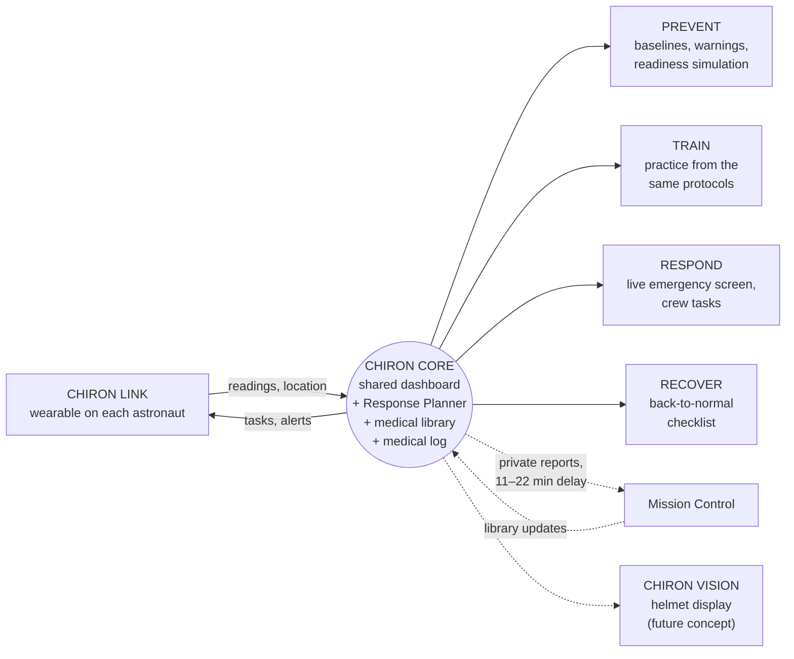

# ⚷ CHIRON

**One connected medical support system for astronauts far from Earth.**

NASA Space Apps Challenge 2026 · Challenge: *Create Health Monitoring Software for Astronauts on Space Missions*

**▶ Try it live: [chiron-hazel.vercel.app](https://chiron-hazel.vercel.app)** · Mission Control console: [chiron-hazel.vercel.app/?earth](https://chiron-hazel.vercel.app/?earth)

On the way to Mars, a message to Earth takes up to 22 minutes each way. There is no evacuation, the crew is four people, and the medical officer may be the one who is ill. CHIRON helps that crew **stay healthy, prepare, respond to an emergency and recover**, using what is already on board: their own readings, their training, their medical kit and approved procedures. It is named after the healer and teacher of Greek myth.

> **Prototype, not a medical device.** All crew, health, wearable and stock data is simulated and labelled as such. The emergency protocols are demo protocols built from published first-aid guidance (each step cites its source); they are not NASA-approved. CHIRON guides; people decide.

---

## Contents

1. [Run it](#run-it)
2. [Five-minute walkthrough for judges](#five-minute-walkthrough-for-judges)
3. [The problem](#the-problem)
4. [The solution: one connected system](#the-solution-one-connected-system)
5. [The main idea: the Response Planner](#the-main-idea-the-response-planner)
6. [Emergency mode in detail](#emergency-mode-in-detail)
7. [Where CHIRON's instructions come from](#where-chirons-instructions-come-from)
8. [NASA data integration](#nasa-data-integration)
9. [How CHIRON meets the judging criteria](#how-chiron-meets-the-judging-criteria)
10. [What works, what is simulated, what is future](#what-works-what-is-simulated-what-is-future)
11. [Privacy and access](#privacy-and-access)
12. [Adding a crew member from a file](#adding-a-crew-member-from-a-file)
13. [Scientific reliability rules](#scientific-reliability-rules)
14. [How it is built](#how-it-is-built)
15. [Limitations and next steps](#limitations-and-next-steps)
16. [Use of Super Intelligence (SI)](#use-of-super-intelligence-si)
17. [License](#license)

---

## Run it

Requires **Node.js 18 or newer**.

```bash
npm install
npm run dev
```

Open the address Vite prints (usually `http://localhost:5173`). Choose a mission: **Mars Transit** shows CHIRON at its most useful, with an 11-minute delay to Earth.

**Several crew devices at once.** On one computer, open a second browser tab: both tabs share the same emergency in real time. To use phones or tablets on the same network:

```bash
npm run relay
npm run dev -- --host
```

Then open the "Network" address Vite prints on each device. Every device also keeps its own copy of the log, so CHIRON keeps working offline and catches up when reconnected. The hosted site syncs tabs in one browser; syncing separate devices online needs a secure relay, set with `VITE_CHIRON_RELAY=wss://…`.

**Mission Control console.** Add `?earth` to the address (for example `http://localhost:5173/?earth`) to open the only screen where the medical library can be changed and where proposed baseline changes are approved.

**Demo PINs** (prototype sign-in, not real security): Ana `1111` · Lena `2222` · Kai `3333` · Ravi `4444`.

| The crew (simulated) | Role | On record |
| --- | --- | --- |
| Ana Rocha | Crew Medical Officer | Penicillin allergy; migraine |
| Lena Sørensen | Backup Crew Medical Officer | Mild asthma in childhood |
| Kai Mensah | Commander | Latex allergy; kidney stone in 2019 |
| Ravi Iyer | Mission specialist | Motion sickness in training; his LINK band is offline in the demo |

---

## Five-minute walkthrough for judges

The **▶ DEMONSTRATION** button (bottom of the home screen) runs the same story with one click per step. Done by hand, it goes like this:

1. **Choose Mars Transit.** The shared crew dashboard opens: each astronaut's general status only (details are private), the CHIRON LINK wearable summary, the four parts of the medical system and a mission dial.
2. **▶ DEMONSTRATION → "Reset the demo"** to start clean.
3. **The monitoring.** Press *Send a low oxygen reading from Ana's band*. The reading travels from her simulated wearable to CHIRON CORE, breaks the prototype warning rule (blood oxygen below 94%), and every device shows a red **LINK WARNING**. Ana's status changes to MEDICAL ATTENTION.
4. **The emergency.** Press *Start the emergency for Ana*, then **Breathing problem**. Every device switches to the live emergency screen.
   - **What is happening to Ana** builds itself from what the crew records.
   - **Measurements** show each value with its time and source; missing ones say NOT RECORDED and can be typed in on the spot.
   - Press **VIEW CREW ASSIGNMENTS**: one column per person, every task in large text. Ana is the patient, so Lena (backup medical officer) leads.
5. **Make it react.** In the columns, answer the questions as they come (*"Can they speak a full sentence?"*, *"Is anyone else short of breath, or is there smoke, a smell or an air alarm?"*, *"After 5 minutes: is breathing easier?"*). Go back to the patient screen after each: the findings appear in the patient's status. Answer **NO** to the 5-minute check and **new tasks appear** (*"Not improving: keep the oxygen on and keep them upright. Send an urgent update to Earth now."*). Press **CAN'T DO THIS** on any step: CHIRON gives a concrete backup, and for some steps hands the task to another crew member.
6. **The coordination.** Open **CHIRON LINK** in the top menu: each band shows *TASK ASSIGNED* with the role, *NO TASK ASSIGNED*, or *MEDICAL EMERGENCY ACTIVE* for the patient. Ravi's band is offline, so CHIRON says "tell them in person".
7. **Earth.** On the emergency screen, **REPORT TO EARTH** shows the private report CHIRON wrote and keeps updating automatically.
8. **End it.** **END EMERGENCY** → confirm. Everything stays in the medical log.
9. **The recovery.** Open Ana's card on the dashboard, enter her PIN `1111`. Her profile shows today's checklist to get back to her normal, the labelled body map, the health line with the readings that make it up, and the medical log.
10. **The evidence.** In the menu: **NASA DATA IN CHIRON** (every NASA source, what kind of source it is, and what it changes in CHIRON) and **ABOUT CHIRON** (system map, what works vs simulated vs future, sources, rules).

---

## The problem

- **Distance.** Today, astronauts on the ISS reach Mission Control in under a second, and can be home in hours. On Mars missions a reply takes up to 44 minutes round trip, and there is no way home.
- **Small crews.** Four people. One or two have medical training. The medical officer can be the patient.
- **Everything at once.** A good response depends on the patient's readings and history, the mission phase, what is in the medical kit, who is trained, who is free, and how far Earth is. Today these live in different places: paper checklists, inventory sheets, wearables, people's memories.
- **Skills fade.** Training happens before launch; an emergency may come 200 days later.

NASA describes this shift as **Earth-Independent Medical Operations**: moving medical decision-making from Earth to the crew ([NTRS 20250000009](https://ntrs.nasa.gov/citations/20250000009)).

---

## The solution: one connected system



| Part | What the crew gets |
| --- | --- |
| **CORE** (shared dashboard) | Who is on board and how each person is doing (general status only), wearable status, alerts first, the mission timeline, and one-tap access to every part. **EMERGENCY MODE** on every screen. |
| **Astronaut profile** (PIN) | Live LINK readings, daily check-in (type, sync from devices, or say it), a body map with labelled parts, "Report something" symptom checker, the health line with every reading under it, the medical record and the mission log. |
| **PREVENT** | Each reading against the person's own normal; warnings for changes that last; checks before the next mission event (for example Mars arrival: muscles, balance, blood pressure); a readiness simulation that plays every emergency through and turns each gap into an action. |
| **TRAIN** | Personal refreshers when a skill has not been practised; practice runs built from the same protocol steps used in a real emergency; measurement guides. |
| **RESPOND** | The live emergency screen, crew tasks, medical stock planning and the crew medical log. |
| **RECOVER** | A daily checklist (exercise, sleep, light, water…) built from the readings that are off the person's normal and fitted into the day's schedule, with progress over time. |
| **CHIRON LINK** | Each astronaut's simulated wearable: readings with timestamps, battery, location, the task CHIRON sent to it, whether it was delivered, and the **Medical State Capsule**: an offline copy of their medical state that reconciles with CORE when the band reconnects (try *Disconnect band*, *Record on band*, *Reconnect*, *Sync and reconcile* on the LINK page). |
| **Medical library** | Read-only on board; only Mission Control can release a new version. Advice is looked up here, fitted to the person's medical record, never generated. |

---

## The main idea: the Response Planner

Medical advice alone is not the hard part. The right response depends on **seven things at once**, and CHIRON joins them into one plan that updates as things change:

| Factor | Where it comes from |
| --- | --- |
| The patient's readings | CHIRON LINK wearable or typed in, each with a time and source |
| Their medical record | Allergies, history, medications (for example Kai's latex allergy changes which gloves to use) |
| Mission phase and conditions | Mission timeline, EVA status |
| Equipment on board | Medical stock list, checked against the protocol; only alternatives written into the protocol |
| Crew medical skills | Qualifications and training record |
| Who is reachable | LINK connection, location, current activity |
| Communication with Earth | The delay for this mission: "act first" at Mars, "ask Earth" near Earth |

The plan picks the protocol, gives each crew member their own tasks, says what is still unknown, and never guesses a missing value. **HOW CHIRON PLANNED THIS** shows the data, rule, protocol and limits behind every decision, which also trains the crew in medical reasoning.

---

## Emergency mode in detail

**Starting it.** Press **EMERGENCY MODE** on any screen, or switch on the microphone and say **"emergency"** (you can also say *"emergency, Kai, breathing"*). Two taps: who, then what. Every crew device switches to the live emergency screen, and anyone signed in is signed out, so each device becomes the shared emergency display.

**The patient screen** (shown first, large text, high contrast):

- **What is happening to the patient**: the reported event, each finding from the crew's checks (for example *"No improvement in breathing, swelling or faintness after the first device"*), treatments recorded and how the patient responded, the latest observations, and the latest valid readings (red when a warning rule is broken). It updates live on every device.
- **Measurements**: each value with its time and source. Simulated wearable readings are labelled. Typed values are checked for plausibility (for example a heart rate of 2000 is refused).
- **Live updates**: observations (*Breathing harder*, *Not responding*, or free text), completed steps, role changes and Earth's replies, each with a time.
- **REPORT TO EARTH**, **MEDICAL RECORD** (opening it is logged), **HOW CHIRON PLANNED THIS**.

**VIEW CREW ASSIGNMENTS** (always in the header): one column per assigned person with their role, status (NOT STARTED / IN PROGRESS / COMPLETED) and **every task in large text**. The current task has the buttons on it: **DONE**, **YES / NO**, **CONFIRM** (for steps the medical lead must confirm) and **CAN'T DO THIS**. Below: who is AVAILABLE or UNAVAILABLE and why.

**The plan changes as the emergency develops:**

- **Follow-up tasks.** Answers decide what comes next. In a severe allergic reaction: *"Five minutes after the first device: are breathing, swelling or faintness improving?"* → **NO** adds *"No improvement after 5 minutes: use a second prescribed, in-date adrenaline auto-injector if available…"* and the oxygen step; **YES** adds continued monitoring, because a reaction can come back hours later.
- **Backups.** **CAN'T DO THIS** always gives a concrete alternative, never just "ask someone". If the lead cannot use the adrenaline auto-injector, a new task goes to another crew member: *"The lead could not use the device. You take the verified, patient-prescribed auto-injector and follow its printed steps exactly."* If nobody can, CHIRON switches to a no-injector backup (keep them supported, do not let them stand or walk, monitor breathing, alert the medical team).
- **Fitted to the patient.** Steps show notes from the patient's record, for example *"Latex allergy on record: use only the latex-free (nitrile) gloves."*
- **Roles can change.** CHIRON suggests who does what; the crew can reassign any role, and everyone's screen and band update.

**Everyone is notified; only the people needed get a task.** **END EMERGENCY** (with confirmation) closes it on every device and keeps the full record.

---

## Where CHIRON's instructions come from

CHIRON gives real instructions, and every treatment step names the published guidance it follows. Medicines and oxygen are only ever the patient's **prescribed, in-date device or the mission's prescribed setting**, used as its label says: **CHIRON never calculates a dose or invents a setting.**

| Emergency | Key instructions | Based on |
| --- | --- | --- |
| Severe allergic reaction | Remove the trigger; look for severe signs even without a rash; use the patient's prescribed adrenaline auto-injector following its printed steps; lie flat, do not stand or walk; a second device if no improvement after 5 minutes; keep watching, as a reaction can return | [ASCIA First Aid Plan for Anaphylaxis](https://www.allergy.org.au/hp/anaphylaxis/first-aid-for-anaphylaxis), [ASCIA: how to give adrenaline devices](https://www.allergy.org.au/hp/anaphylaxis/how-to-give-devices), [Resuscitation Council UK (2021)](https://www.resus.org.uk/library/additional-guidance/guidance-anaphylaxis/emergency-treatment) |
| Breathing problem or cabin air | Check if they can speak a full sentence; sit upright; check the cabin air and follow the cabin-atmosphere card if others are affected; oxygen at the mission's prescribed setting; re-check after 5 minutes | [British Thoracic Society emergency oxygen guideline](https://www.brit-thoracic.org.uk/clinical-resources/guidelines/emergency-oxygen/), [NHS: asthma attack](https://www.nhs.uk/conditions/asthma/asthma-attack/) |
| Decompression sickness after EVA | 100% oxygen as soon as possible; fluids by mouth if awake; check feeling, strength and speech; prepare recompression if not improving | [Divers Alert Network](https://dan.org/safety-prevention/diver-safety/divers-blog/treating-decompression-sickness-the-bends/) |
| Panic or distress | Private support; physical causes checked first | Demo content |

The protocols live in `src/emergency/data.ts`. A real mission would load its own approved protocols in the same format.

---

## NASA data integration

For every source: what kind of source it is, what it provides, which need it addresses, which CHIRON function uses it, and what changes as a result. The same table is in the app under **NASA DATA IN CHIRON**.

| Type | Source | CHIRON function | Practical output |
| --- | --- | --- | --- |
| **Dataset** | [NASA Open Science Data Repository (OSDR)](https://osdr.nasa.gov/bio/repo/) | Health insights; library science section | When a reading is flagged, CHIRON lists the real OSDR studies (OSD-…) for that body system. Fetched with `npm run fetch-research` and stored in `src/data/snapshots/osdr.json` |
| Standard | [NASA-STD-3001 Vol. 1, §6 Medical Operations](https://www.nasa.gov/reference/6-0-medical-operations/) | Emergency roles; Earth reports | The medical officer or backup leads; reports are marked private medical communication and sent store-and-forward |
| Research gap | [Human Research Roadmap](https://humanresearchroadmap.nasa.gov/) · Medical-401 | Stock planning; readiness simulation | Every protocol is checked against the mission's stock (missing, last use, expiring before mission end); gaps listed per emergency |
| Research gap | [Human Research Roadmap](https://humanresearchroadmap.nasa.gov/) · Medical-701 | Response Planner | One plan from equipment, training and readings already on board; no extra hardware |
| Concept of operations | [EIMO ConOps, NTRS 20250000009](https://ntrs.nasa.gov/citations/20250000009) | Library, LINK, practice, planner | Each EIMO element (reference database, wearable sensors, training tools for the medical officer) has a CHIRON part |
| Research | [EIMO Technical Interchange Meetings, NTRS 20250000057](https://ntrs.nasa.gov/citations/20250000057) | "How CHIRON got here" | Every recommendation shows its data, rule, protocol and limits |
| Research | [Medical capability gaps beyond LEO, NTRS 20230007411](https://ntrs.nasa.gov/citations/20230007411) | Whole system | Mission settings change behaviour: "act first" at Mars, "ask Earth" near Earth |
| Research | [NASA HRP: human spaceflight risks](https://www.nasa.gov/hrp/risks/) | PREVENT readings and event checks; RECOVER | Each tracked reading is tied to a spaceflight hazard (altered gravity, isolation, radiation, distance, hostile environment) |
| Model | [NASA Integrated Medical Model](https://www.nasa.gov/nasa-integrated-medical-model-imm-overview/) | Readiness simulation (proposed) | Future: weight emergencies by how likely they are |

**Only OSDR is live data.** Standards, research gaps and concepts are documents that shaped the design; none is presented as a dataset.

---

## How CHIRON meets the judging criteria

**Impact.** Deep-space crews must act before Earth can answer. CHIRON turns the crew's own readings, training, stock and procedures into prepared, coordinated action, so the right person does the right step even when the medical officer is the patient, and it reports to Earth automatically. *See: walkthrough steps 3–8.*

**Creativity.** The Response Planner is not "AI medical advice". It joins seven mission factors (patient, record, mission, equipment, skills, availability, Earth delay) into one transparent operational plan that changes as answers come in, and explains every decision. *See: VIEW CREW ASSIGNMENTS and HOW CHIRON PLANNED THIS.*

**Validity and feasibility.** Runs in any browser, offline, with no AI service or API key: instructions are looked up in versioned protocols and a library, never generated, so the same input always gives the same, checkable output. Every treatment step cites published guidance. Simulated data is labelled, old data is never shown as live, missing data is never estimated, warning limits are marked as prototype rules, and the app states clearly what is built, simulated or future. *See: ABOUT CHIRON.*

**Relevance.** Every part maps to one of the six exploration medical objectives:

| Objective | CHIRON function |
| --- | --- |
| 1. Personalized medicine | Personal baselines for every reading; advice and emergency steps fitted to each medical record; body map; symptom checker that uses the person's readings and history |
| 2. Independent medical training | TRAIN practice built from the real protocol steps; refreshers from each person's training record; "How CHIRON got here" on every recommendation |
| 3. Computer-based decision support | Medical library; emergency protocols with backups and follow-ups; live patient status; crew tasks |
| 4. Fewer medical resources | Stock planning against every protocol: missing, last use, expiring before mission end; approved alternatives only |
| 5. Medical risk prediction | Readiness simulation per emergency; checks before the next mission event; LINK warning rules |
| 6. Rehabilitation | RECOVER checklist built from the person's readings and schedule; progress timelines |

**NASA data integration.** See the table above and the in-app NASA DATA page.

**Presentation.** The ▶ DEMONSTRATION page follows one astronaut, Ana, through the mission in seven steps, each opening the real screen. The system map and the mission dial give CHIRON a recognisable Greek, Antikythera-inspired identity.

---

## What works, what is simulated, what is future

| Works in the prototype | Working simulation (logic runs, inputs simulated) | Future concept (not built) |
| --- | --- | --- |
| Shared dashboard, mission page, protected profiles with PIN | CHIRON LINK wearables: a reading reaches CORE, breaks a warning rule and alerts every device | Physical LINK hardware, haptics, suit integration |
| Daily check-in (type, sync from device, or say it) | Band location, battery, vibration, emergency button | CHIRON VISION helmet display |
| Body map, symptom checker, plain-language advice | Readiness simulation | Predictive models validated by medical teams |
| Read-only medical library, changed only by Mission Control | Crew task suggestions with reasons | Automated resource intelligence |
| Emergency mode on every device: live patient status, crew tasks, follow-ups and backups | Procedure handover | Adaptive, medically approved rehabilitation |
| Response Planner overview; transparent task ranking (qualification, proximity, training recency, workload, roster tie-break); assignments PROPOSED until the response lead confirms | Stock planning with reservations for active emergencies and device service dates | More onboard autonomy |
| Automatic private reports to Earth with their states (prepared → queued → transmitted → received → reviewed → response received) | Training recommendations | |
| Alert lifecycle on the dashboard: generated, sent, delivered, acknowledged, reviewed (medical officer PIN), resolved | Medical State Capsule: offline copy on each band, entries recorded offline, conflict-aware reconciliation on reconnect | Physical Capsule on a real band |
| Library updates integrity-checked (demo key); personal baselines proposed on board and approved by Mission Control as new versions | | Public-key signatures; baselines feeding the health flags |
| Recovery checklist and timelines, medical log, voice commands, adding a crew member from a file | | |

---

## Privacy and access

One shared dashboard for the whole crew, individual protected profiles:

- The **shared dashboard** shows only each person's general status, LINK connection and alert count. Personal readings never appear outside a profile.
- A **profile asks for that astronaut's PIN on every visit**, including your own, and locks again when you leave it. **LOG OUT** ends the session for the next person.
- **Medical officers** can open another person's profile with their own PIN. **Anyone** can use **emergency access** after choosing a reason. Both are written in the medical log, where the owner can see who opened it, when and why.
- During an emergency, opening the patient's medical record is also logged.

This shows the access model; PINs are demo values checked in the browser, not real security.

---

## Adding a crew member from a file

On the dashboard, **ADD A CREW MEMBER FROM A FILE** loads one JSON crew file. CHIRON checks every field and lists exactly what is missing; when the file is complete it builds the person's dashboard card, profile, medical record, LINK band, responsibilities and training record. The dialog offers an empty template and shows the format (`src/access/crewFile.ts`):

```json
{
  "format": "chiron-crew-file",
  "version": 1,
  "id": "mei",
  "name": "Mei Tanaka",
  "position": "Payload specialist",
  "qualifications": ["life-support", "comms"],
  "pin": "5555",
  "medical": { "allergies": [], "medications": [], "history": [], "restrictions": [], "notes": "" },
  "duties": ["Payload operations"],
  "link": { "location": "Laboratory", "activity": "Science experiment" }
}
```

Allowed qualifications: `cmo`, `cmo-backup`, `life-support`, `eva`, `comms`, `peer-support`. The new member's health history is simulated like the rest of the crew's, and they are stored on the device where the file was loaded.

---

## Scientific reliability rules

CHIRON follows these everywhere:

1. Every reading shows where it came from and when.
2. Simulated data is labelled SIMULATED.
3. Old data is never shown as live; a disconnected band shows LAST KNOWN.
4. Missing data is shown as missing, never guessed.
5. Warning limits are marked as prototype rules, not clinical criteria.
6. Treatment steps come only from protocols in the library, and each cites its source. No doses or device settings are calculated; only prescribed, in-date devices are used.
7. Only equipment alternatives written into a protocol are suggested.
8. Every recommendation can show how CHIRON reached it.
9. CHIRON flags and guides; it does not diagnose. The medical officer or flight surgeon confirms.

---

## How it is built

- **React 18 + TypeScript + Vite**, styled with **Tailwind CSS 4**; **three.js** for the space background; **lucide-react** icons.
- **One shared event log.** Every action (a step done, a reading, a role change, a report) is an event. Each device rebuilds the emergency, the plan and the crew tasks from the log, so all screens agree. Events travel between tabs (BroadcastChannel), between devices (a small WebSocket relay, `scripts/relay.mjs`), and are stored on each device (localStorage) for offline use.
- **No AI service and no server-side data.** Deterministic rules, protocols and a library, so results can be checked and reproduced.
- **Voice** uses the browser's Web Speech API where available (Chrome and Edge).

| Path | What it holds |
| --- | --- |
| `src/App.tsx` | Screens, sign-in, emergency switching, voice commands |
| `src/components/MissionDashboard.tsx` | Header and shared dashboard |
| `src/components/pages/` | Profile, PREVENT/TRAIN, RESPOND, LINK, Mission, NASA data, About, Demonstration |
| `src/components/act/` | Emergency mode: start screen, live patient screen, crew assignments, Response Planner |
| `src/emergency/` | Protocols and sources (`data.ts`), plan engine, role assignment, live patient status (`board.ts`), shared log, Earth reports |
| `src/library/` | Medical library and advice fitted to the medical record |
| `src/link/` | Simulated wearables and prototype warning rules |
| `src/access/` | Roles, demo PINs, crew-file format |
| `src/triage/` | "Report something" symptom checker |
| `src/prevent/`, `src/train/`, `src/recover/` | Readiness simulation, training records, recovery checklist |
| `src/data/` | Indicators, missions, simulated health history, OSDR research snapshot |
| `scripts/` | `relay.mjs` (multi-device sync), `fetch-research.mjs` (refresh the OSDR snapshot) |

---

## Limitations and next steps

**Limitations (honest):** all health, wearable and stock data is simulated; the protocols are demo protocols, not approved by NASA or a flight surgeon; warning limits are prototype rules; PINs are not real security; voice depends on the browser; a crew member added from a file exists only on the device where they were added.

**Next steps:** connect real wearables; load a mission's approved protocols and formulary through the Mission Control console; validate the readiness simulation with NASA's Integrated Medical Model; build CHIRON VISION for hands-busy guidance; real authentication and encrypted records.

---

## Use of Super Intelligence (SI)

As the NASA Space Apps rules require, this is where and how SI tools were used. No SI-generated content uses, contains or changes NASA branding (logos, flags or mission identifiers).

| What | SI used? | How, and how it is marked |
| --- | --- | --- |
| **Code** | Yes | Written by the team with help from the AI coding assistants **Claude Code** (Anthropic) and **GitHub Copilot**, which suggested and reviewed code under our direction. Acknowledged here, in `package.json` (`siDisclosure`) and in the page metadata (`<meta name="si-disclosure">` in `index.html`). |
| **Data** | Partly | The simulated crew, readings, stock and scenarios were generated by code that was written with SI help (above). The OSDR study list is real NASA data, downloaded by `scripts/fetch-research.mjs`, not generated. |
| **Text** | Yes | README, in-app wording, the project description and the presentation were drafted with help from Claude and edited by the team. |
| **Images** | Concept art only | The CHIRON LINK WATCH, VISION and HELMET pictures and the Medical State Capsule tablet picture in the presentation are SI-generated concept art. Each has a visible **"SI-GENERATED IMAGE"** watermark. The app itself contains no SI-generated images (the planet textures are from public imagery, and the screenshots are of the real app). |
| **Audio** | No | CHIRON's spoken words use the browser's built-in text-to-speech at run time, and the alarm is a tone generated in code. No SI-generated audio files are included. |
| **Medical logic** | No | The Response Planner, crew ranking, warnings, readiness check and symptom checker are deterministic rules. No AI model makes or generates medical decisions. |

Every design, medical and source decision was the team's.

---

## License

[MIT](LICENSE). The code is free to use, change and share with the copyright notice kept. The simulated data and demo protocols are for demonstration only and are not medical advice.
